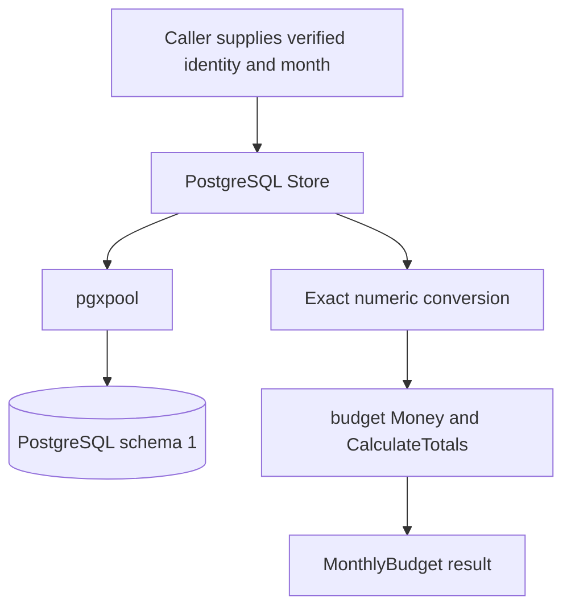

# Issue #7 theory: PostgreSQL owner lookup and monthly budget reads

This guide explains the implementation and design reasoning behind
[budget-service issue #7](https://github.com/finance-lab-project/budget-service/issues/7).
It covers the current adapter changes, their tests, and the existing domain and
database concepts needed to understand them. At authoring time, these changes
are an uncommitted delivery; this document does not assign them a PR number.

The implementation reads an existing owner's monthly budget from PostgreSQL,
preserves exact identity and money values, and returns domain-calculated totals.
The public entry points are `postgres.Open`, `Store.ReadMonthly`, and
`Store.Close`.

Use the [adapter guide](postgres-adapter.md) for operational commands and the
[step 9 evidence](evidence/issue-7/verification.md) for observed verification.
This learning document was added after that verification snapshot; it does not
expand its manifest or record maintainer acceptance.

## 1. What this change adds

| Area | Role in this work |
| --- | --- |
| `internal/budget` | Existing database-independent money, month, category and totals rules; unchanged |
| PostgreSQL schema version 1 | Existing owner, budget and receipt storage; unchanged |
| `internal/postgres` | New pool ownership, existing-owner lookup, exact decoding and monthly read implementation |
| `go.mod` / `go.sum` | Pin pgx v5.11.0 and record its dependencies/checksums |
| Storage workflow | Extend existing database checks with adapter integration tests |
| Documentation and evidence | Explain usage, boundaries, reproduction and completed checks |

The service Go baseline is 1.27.3. The integration target is PostgreSQL 18.6
with schema version 1; Goose v3.29.0 applies migrations separately.

The adapter does not implement HTTP handlers, JWT verification, owner creation,
budget saves, optimistic concurrency, receipt replay, retention workers, recovery
fencing or deployment. Those concepts appear in the wider contract, but a
working read adapter does not establish their implementation.

## 2. Architecture and dependency direction

The domain expresses budgeting rules. The adapter translates between database
representations and those rules.



The dependency direction is `postgres -> budget`. The domain imports neither
pgx nor the adapter. This keeps money arithmetic usable and testable without a
database and prevents driver details from becoming business rules.

`MonthlyBudget` contains:

- `Month`: the canonical stored month.
- `Revision`: a positive `int64` version.
- `Planned`: currency, income, investments and all 15 spending categories.
- `Totals`: exact income, spending, investments and remaining amounts.

The result exposes no internal owner ID, pool or `pgtype.Numeric`. The caller
receives domain values rather than database objects. Go's `internal` directory
also restricts which packages may import the implementation.

The private `rowQuerier` interface contains only `QueryRow`. Production passes
the pool; unit tests pass a controlled substitute. This gives tests access to
rare lookup outcomes without introducing a public repository framework.

Source: [package contract](../internal/postgres/doc.go),
[result types](../internal/postgres/postgres.go),
[private query interface](../internal/postgres/owner.go).

## 3. pgx, connections and pool ownership

### Why a pool exists

A database connection is a network session with PostgreSQL. Reusing established
connections avoids reconnecting for every read. `pgxpool` manages their
acquisition, reuse and release; `Store` owns that pool.

This implementation uses pgx's native API, including `pgtype.Numeric`, rather
than adding a `database/sql` wrapper. Its code is intentionally specific to
PostgreSQL.

The intended lifecycle is:

```text
service startup: Open -> verify connection -> keep Store
each request:   ReadMonthly(request context, verified identity, month)
shutdown:      finish in-flight requests -> Close
```

Construct one reusable Store at startup. Opening and closing a pool for each
request defeats its purpose. `Store{}` is not initialized for reads, even though
closing a nil or zero Store is safe.

### Why construction includes Ping

Parsing a connection string proves that configuration can be interpreted; it
does not prove that a reachable database accepts the credentials. `Open` calls
`Ping` before returning a successful Store. Connectivity is established at
initialization, without promising that the database will remain available.

`Open` rejects an empty connection string and a nonpositive timeout. Malformed
driver configuration is an input error. Connection or ping failures are
database errors, and no Store is returned on failure.

### Three timing concerns

| Mechanism | What it bounds |
| --- | --- |
| Caller context | Cancellation or a deadline imposed by the startup caller |
| `connectTimeout` | The initialization context, and a cap on individual connection attempts |
| DSN `connect_timeout` | A connection-attempt setting; a tighter existing value is preserved |

The startup context is derived with `context.WithTimeout`. An earlier parent
deadline still wins. A separate per-connection cap matters because a background
connection attempt may continue after a caller stops waiting for acquisition.

The successful Store outlives its initialization context. Each subsequent read
uses its own request context. Canceling startup's context after successful
initialization does not close the pool.

### Cancellation and cleanup are different events

When initial Ping fails, `Open` starts `pool.Close` in a goroutine. Driver socket
cleanup can take longer than the caller's cancellation deadline. Waiting for
that cleanup inline would delay returning the failure.

This does not mean resources are intentionally abandoned: cleanup is started,
connection attempts are bounded, and tests check eventual disconnection. It
means that return from `Open` and completion of socket cleanup need not coincide.

For normal shutdown, `Close` waits for acquired connections to return and is
safe to repeat. Shutdown should therefore finish in-flight work before closing
the Store.

Source: [pool implementation](../internal/postgres/pool.go),
[pool tests](../internal/postgres/pool_test.go),
[blocked Ping cleanup test](../internal/postgres/ping_cleanup_test.go).

## 4. Identity: verified claims, exact bytes and digest lookup

### Identity is a pair

An owner is identified by `(issuer, subject)`. A subject is meaningful within
its issuer, so these synthetic pairs represent different owners:

```text
(https://identity.example.invalid/realm-a, user-a)
(https://identity.example.invalid/realm-b, user-a)
```

The adapter accepts identity strings from an already verified and authorized
caller. It does not verify a bearer token, signature, issuer allowlist, audience
or request permissions. Valid UTF-8 is an input property, not authentication.

`lookupOwner` validates issuer, subject and month before its first query:

- Issuer and subject must be nonempty valid UTF-8.
- Month must be exactly `YYYY-MM`, year 0001–9999, month 01–12.
- Valid identity bytes are preserved without further normalization.

Month validation requires no timezone or current clock: a budget month is a
calendar label, not a timestamp.

### Why identities are not normalized

Changing case, trimming spaces, normalizing a URL or normalizing Unicode could
merge distinct authenticated subjects. For example, `user-a`, `User-a` and
`user-a ` remain different. Composed `é` and decomposed `e` plus a combining
accent have different UTF-8 bytes even when their appearance is similar.

The adapter also imposes no UUID requirement. A valid subject can be any
nonempty UTF-8 string allowed by the upstream identity system.

PostgreSQL stores the original bytes as `BYTEA`. This makes exact byte
comparison explicit and avoids relying on text collation for identity equality.

### Why the index uses SHA-256

The existing unique expression index is on:

```sql
(sha256(issuer_bytes), sha256(subject_bytes))
```

Digest keys have fixed size, allowing lookup without indexing arbitrarily long
original claims directly. The originals are retained because a hash is not a
proof of equality. This use of hashing is an indexing choice, not encryption
or anonymization.

The lookup is parameterized:

```sql
SELECT id, issuer_bytes, subject_bytes
FROM public.budget_owners
WHERE sha256(issuer_bytes) = sha256($1::bytea)
  AND sha256(subject_bytes) = sha256($2::bytea)
```

The caller's values are passed separately as byte parameters; their contents
are not interpolated into SQL syntax. Parameters protect the value boundary.
They do not, by themselves, prove ownership or authorization.

### A digest match is only a candidate

After scanning the row, the adapter compares both original byte strings with
the request. Only exact equality allows the internal ID to be used for a
budget query.

If either differs, the operation returns `ErrIdentityIntegrity`, with no result
and no monthly query. Treating this as ordinary absence could hide an integrity
failure; accepting it could expose another owner's data.

The mismatch unit tests inject a candidate through `rowQuerier`. They exercise
the fail-closed branch without claiming to generate a real SHA-256 collision.

Source: [owner lookup](../internal/postgres/owner.go),
[identity tests](../internal/postgres/owner_test.go),
[existing owner schema](storage.md#owners).

## 5. The monthly read, step by step

1. Validate identity and month.
2. Resolve an existing owner and compare both original identity byte strings.
3. Query the budget using that internal owner ID and the requested month.
4. Scan metadata and all 17 source amounts.
5. Validate the stored month, positive revision and supported currency.
6. Convert every amount exactly into domain Money or unplanned `nil`.
7. Build the complete spending map and call `budget.CalculateTotals`.
8. Return the complete `MonthlyBudget` only after every stage succeeds.

There are at most two parameterized application queries: one owner SELECT and
one monthly SELECT. Missing owners stop after the first. Missing months stop
after the second. Both produce `ErrNotFound`; neither creates an empty budget
or allocates an owner ID.

The monthly primary key is `(owner_id, month)`, so the query selects at most one
budget. Both conditions matter: filtering only by month would mix owners, and
filtering only by owner would mix months.

### Explicit mapping

The SELECT names its columns explicitly instead of using `SELECT *`. Scan
destinations must match that order. This makes schema-to-domain mapping visible
in the source and testable with distinct amounts in every column.

| SQL source | Result |
| --- | --- |
| `month`, `revision`, `currency` | Budget metadata |
| `income`, `investments` | Respective planned amounts |
| 15 spending columns | Complete `Planned.Spending` map |
| `personal_care` | Domain key `personal-care` |

The spending keys are `groceries`, `restaurants`, `utilities`, `transport`,
`household`, `health`, `personal-care`, `clothing`, `subscriptions`, `education`,
`tech`, `culture`, `entertainment`, `gifts` and `travel`.

There is a map entry for every category, including unplanned ones. A missing
category is structurally different from a present category whose amount is nil.
The domain validates this complete category set.

The row's currency supplies the currency of every populated amount. Currency
is validated even if all 17 amounts are NULL, so an all-unplanned budget cannot
bypass currency validation.

### Complete results and statement boundaries

Any failure returns a nil result. A partially decoded budget is never returned
with an error, which prevents callers from accidentally using incomplete totals.

All budget metadata and amounts come from one monthly SELECT, avoiding separate
queries for individual fields. The owner and monthly SELECTs are separate
statements; the adapter does not wrap them in a shared transaction or claim a
single snapshot spanning both. This implementation provides no write-conflict
or optimistic-concurrency protocol.

### Revision stays exact

PostgreSQL BIGINT and Go `int64` support the positive revision range through
`9223372036854775807`. A future HTTP boundary must serialize revision as a decimal
string, for example with `strconv.FormatInt(revision, 10)`. A floating-point
representation cannot preserve every integer in this range.

The adapter only reads revisions. It does not increment them, compare an
expected version or implement version exhaustion handling for saves.

Source: [monthly read](../internal/postgres/monthly.go),
[mapping tests](../internal/postgres/monthly_test.go),
[month validation](../internal/budget/month.go).

## 6. Money: exact decimal values across the storage boundary

### Why millionths and big integers

The domain represents money as integer millionths: one unit of currency equals
1,000,000 internal units. This preserves up to six decimal places exactly.

```text
0.1      ->   100000 millionths
0.2      ->   200000 millionths
0.3      ->   300000 millionths
0.000001 ->        1 millionth
```

Binary floating point cannot represent every decimal fraction exactly. It also
cannot preserve all large integers supported here. The implementation therefore
never converts stored amounts through `float64`.

A planned amount can have up to 18 integer digits and six fractional digits:

```text
maximum source amount = 999999999999999999.999999
maximum source units  = 999999999999999999999999 = 10^24 - 1
```

That unit count exceeds signed 64-bit capacity. `math/big.Int` supports exact
arithmetic for both source values and larger derived totals.

### Why the existing SQL domain is unconstrained NUMERIC

The amount domain uses `NUMERIC` with checks for finite values, a nonnegative
value below `10^18`, and `value = trunc(value, 6)`.

That equality checks whether the original value is representable at six places.
It does not replace the value with a truncated result. A declared fixed scale
such as `NUMERIC(24,6)` can round on assignment before a later constraint checks
the value. The existing schema instead rejects excess significant precision.

The adapter selects each amount with an unconstrained `::numeric` cast so pgx
can decode the domain's base numeric value. The cast introduces no scale or
rounding rule.

### Coefficient and exponent

`pgtype.Numeric` represents a finite number using an integer coefficient `C`
and decimal exponent `E`:

```text
value      = C * 10^E
millionths = C * 10^(E + 6)
```

Let `shift = E + 6`:

- If `shift >= 0`, multiply the coefficient by `10^shift`.
- If `shift < 0`, divide by `10^(-shift)` and require a zero remainder.
- A nonzero remainder means the value cannot be represented exactly in
  millionths. Reject it; never round, clamp or discard digits.

| Stored value | Possible C | E | Conversion | Outcome |
| --- | --- | --- | --- | --- |
| `12.34` | 1234 | -2 | 1234 × 10000 | 12340000 units → `"12.34"` |
| `1.0000000` | 10000000 | -7 | 10000000 ÷ 10 | 1000000 units → `"1"` |
| `0.0000010` | 10 | -7 | 10 ÷ 10 | 1 unit → `"0.000001"` |
| `0.0000001` | 1 | -7 | 1 ÷ 10, remainder 1 | Rejected |
| `1.0000001` | 10000001 | -7 | 10000001 ÷ 10, remainder 1 | Rejected |

Coefficient/exponent pairs need not have one unique spelling. Exact numerical
value, rather than a specific representation, determines acceptance.

### Bounds and invalid values

The converter rejects NaN, infinities, invalid infinity flags, missing
coefficients, negative values, values outside the source range and nonzero
sub-millionth precision.

It widens the exponent to `int64` before adding six, avoiding overflow in that
addition. For nonzero values it checks the prospective unit digit count before
building a power of ten. This bounds multiplication and rejects impossible
extreme exponents without constructing enormous powers unnecessarily. Division
still checks its remainder; the digit count alone cannot prove exactness.

Zero is handled separately. Its value remains zero even with an extreme
exponent, so it needs no power-of-ten calculation.

### Storage normalization does not relax the API parser

Database NUMERIC describes a value; the API contract also specifies its spelling.
Stored `1.0000000` is numerically one and can become canonical `"1"`. Incoming
`budget.ParseMoney("1.0000000", currency)` remains invalid because the parser
requires canonical text.

After obtaining exact units, the converter formats canonical decimal text and
passes it to the unchanged domain parser. This reuses domain validation and
keeps SQL representation handling inside the adapter.

### Ownership of big integers

`big.Int` operations can mutate their receiver. The converter calculates into
fresh storage and does not modify `pgtype.Numeric.Int`. The domain parser
creates independent Money storage, and the Money API does not expose its
private integer for mutation.

Tests convert a numeric more than once and mutate the original coefficient
afterward. Previously returned Money values must remain unchanged.

Source: [numeric conversion](../internal/postgres/numeric.go),
[numeric tests](../internal/postgres/numeric_test.go),
[domain Money](../internal/budget/money.go),
[SQL amount constraints](../migrations/00001_initial_budget_schema.sql).

## 7. NULL, planned zero and totals

Unplanned and planned zero carry different information:

| Database value | Go planned value | Meaning |
| --- | --- | --- |
| SQL NULL | `nil` pointer | No amount has been planned |
| Numeric zero | Non-nil valid Money whose `Amount()` is `"0"` | An explicit zero is planned |
| Positive numeric | Non-nil valid Money | A positive amount is planned |

An uninitialized `budget.Money{}` is invalid. It is neither unplanned nil nor
a valid planned zero. Returning it as zero would erase a useful distinction.

For arithmetic, unplanned amounts contribute zero. Their planned fields still
remain nil. The existing `budget.CalculateTotals` computes:

```text
totalIncome      = income, or zero when unplanned
totalSpending    = sum of all 15 spending amounts, nil contributing zero
totalInvestments = investments, or zero when unplanned
remaining        = totalIncome - totalSpending - totalInvestments
```

For a synthetic USD budget with income `"100"`, groceries `"30.5"`, investments
`"20"`, and all other categories unplanned, the totals are `"100"`, `"30.5"`,
`"20"` and `"49.5"`. Those unplanned category entries remain nil in `Planned`.

Totals are derived in Go rather than read from authoritative total columns.
This uses one existing arithmetic implementation and prevents separately stored
totals from disagreeing with the planned fields.

Source bounds and result bounds differ. Each planned amount must stay within
the source limit, but their sum can exceed it. For example, 15 maximum spending
amounts total `14999999999999999999.999985`. Remaining may be negative when
spending and investments exceed income. Neither result should be clamped.

All participating Money values must have the budget currency. This is
same-currency arithmetic, not currency conversion. The domain validates the
category set and source values and calculates without mutating its input.

Source: [totals implementation](../internal/budget/totals.go),
[monthly mapping tests](../internal/postgres/monthly_test.go).

## 8. Errors: category, cause and safe presentation

An error needs to explain what operation failed while remaining useful for
programmatic decisions.

| Category | Meaning |
| --- | --- |
| `ErrInvalidInput` | Invalid caller configuration, identity or month |
| `ErrNotFound` | The owner or monthly budget does not exist |
| `ErrIdentityIntegrity` | A digest candidate's original identity bytes differ |
| `ErrInvalidStoredData` | Successfully decoded values cannot form a valid budget |
| `ErrDatabase` | Connection, query/scan, permission, cancellation or deadline failure |

Malformed caller input and invalid stored data have different origins. A
permission denial or timeout also must not be converted into absence: otherwise
an outage could look like a new user's empty budget.

`operationError` stores an operation, category and original cause. Its displayed
text contains the operation and category, while `Unwrap() []error` exposes both
the category and cause to Go's error traversal.

For example, a cancellation can simultaneously satisfy:

```go
errors.Is(err, postgres.ErrDatabase)
errors.Is(err, context.Canceled)
```

A typed driver error can be inspected without parsing its message:

```go
var pgErr *pgconn.PgError
if errors.As(err, &pgErr) {
    // Inspect pgErr.Code; 42501 identifies insufficient privilege.
}
```

These are inspection fragments, not an HTTP error-mapping implementation.
Month failures similarly preserve `budget.ErrInvalidMonth`; invalid stored
amounts preserve their relevant domain cause.

Driver configuration errors can contain the original connection string,
including credentials. The displayed wrapper omits those details while keeping
the cause inspectable. Callers must not defeat that boundary by logging the
unwrapped error or connection configuration. The adapter itself logs no
identity values or private budget contents.

Source: [error definitions and wrapper](../internal/postgres/errors.go),
[configuration privacy tests](../internal/postgres/pool_test.go).

## 9. Database roles, migrations and the read-only guarantee

### Separate setup from application access

`budget_migrator` owns and prepares schema objects. `budget_runtime` is the
application login. Integration fixtures and schema-version inspection use
the former; adapter reads use the latter.

Testing reads as the schema owner would hide missing runtime grants. Tests
therefore check both `current_user` and `session_user`, not just the username
written in a connection string.

The runtime role is restricted, but it is not a database-wide SELECT-only role:
the existing schema grants selected write operations for future save work. It
also is not an individual end user's authorization identity. Read-only behavior
here follows from the adapter's code and its verification, while owner isolation
depends on the verified identity and correctly scoped queries.

The runtime pool does not apply migrations or read Goose bookkeeping. Migration
execution remains a separate administrative operation. Applied migrations are
preserved; future schema changes need new numbered migrations.

### What "reads make no writes" means

Successful, absent and failed reads must not modify owners, budgets or receipts,
and must not consume owner sequence values. PostgreSQL may acquire locks and
update its own internal statistics during SELECTs; the guarantee concerns
application data and owner ID allocation.

Row counts alone would miss updates. The integration suite snapshots complete,
deterministically ordered row contents of all three application tables and the
owner sequence's `last_value` and `is_called`. It compares this snapshot after
each read scenario.

The baseline is taken after setup. Schema probes and fixture inserts allocate
sequence values legitimately, and sequence allocation is not rolled back with
the surrounding transaction. Comparing against a pre-setup baseline would
incorrectly blame reads for fixture setup. Cleanup deletes only owned fixture
rows and does not rewind the sequence.

Source: [runtime grants](storage.md#runtime-grants),
[snapshot helpers](../internal/postgres/integration_test.go),
[fixture and read checks](../internal/postgres/monthly_integration_test.go).

## 10. How the tests establish the behavior

### Unit tests

Ordinary tests need no PostgreSQL installation. They verify validation order,
parameters, mapping, decimal conversion, error identity and complete-result
behavior. Controlled query results allow invalid stored metadata and digest
mismatches to be exercised even when the normal schema prevents them.

Pool unit tests use local TCP listeners to model refused connections, stalled
startup and blocked Ping cleanup. Observed connection events make these checks
stronger than assuming that a sleep means the driver reached a particular stage.

The numeric cases include all supported currencies, NULL/zero, padded decimals,
one millionth, source maxima, values beyond floating-point integer precision,
extreme exponents, nonfinite values and input/output independence.

### Real PostgreSQL integration tests

Files with `//go:build integration` are included only when the build tag is
selected. Ordinary `go test ./...` does not run those database scenarios.

The selected suite requires:

| Variable | Purpose |
| --- | --- |
| `BUDGET_TEST_DISPOSABLE_DATABASE` | Explicitly selects the disposable database name |
| `BUDGET_TEST_SETUP_DSN` | Setup connection as `budget_migrator` |
| `BUDGET_TEST_RUNTIME_DSN` | Adapter connection as `budget_runtime` |

The connections must select the same host, port and database. The suite checks
actual logins, PostgreSQL 18.6 and applied schema version 1. Fixture setup
requires empty application tables and refuses to reset existing data.

Missing configuration or an unavailable database fails an explicitly selected
integration run. A passing skip would give false confidence that database
behavior had been exercised.

Recorded integration coverage includes distinct exact-byte identities, separate
owners/months, all categories and currencies, maximum revision, decimal padding,
NULL/zero, exact totals, large totals, negative remaining and missing data.

### Real permission failures

The setup connection temporarily revokes runtime SELECT on each relevant table.
The actual adapter call must fail as `ErrDatabase`, preserve a `*pgconn.PgError`
with SQLSTATE `42501`, and return no budget. Cleanup restores the grants.

### Cancellation after the query actually blocks

The test holds an `ACCESS EXCLUSIVE` lock on the monthly table from a separate
setup transaction. It starts the read, then observes the runtime backend's
ungranted `AccessShareLock` in `pg_locks` before testing cancellation/deadline
behavior. Reaching that wait demonstrates that owner lookup has already
completed and the monthly SELECT is blocked.

The result must retain the context cause, return no budget and leave application
state unchanged. A subsequent successful read checks that the Store remains
usable even if cancellation retired a connection.

### Pool integration lifecycle

The real pool test verifies an established connection, continued usability after
the initialization context ends, repeated Close, zero remaining pool connections
and refusal of new acquisition after closure.

Source: [integration configuration](../internal/postgres/integration_test.go),
[monthly integration scenarios](../internal/postgres/monthly_integration_test.go),
[pool integration test](../internal/postgres/pool_integration_test.go).

## 11. CI, reproducibility and evidence

The storage workflow runs ordinary Go tests/vet, installs the pinned Goose CLI,
starts its isolated PostgreSQL instance, verifies roles and migrations, checks
schema constraints, and then selects adapter integration tests. Schema checks
run before adapter fixtures because they require empty application tables.

Each CI run/attempt uses a distinct Compose project. Startup waits for database
health. On failure the workflow collects database diagnostics; an `always()`
step removes its disposable resources. These controls concern test isolation,
not application deployment.

Useful commands from the repository root are:

```sh
GOTOOLCHAIN=go1.27.3 go test -count=1 ./...
GOTOOLCHAIN=go1.27.3 go vet ./...
GOTOOLCHAIN=go1.27.3 go vet -tags=integration ./internal/postgres
# After the disposable database, roles, schema and environment are prepared:
GOTOOLCHAIN=go1.27.3 go test -tags=integration -count=1 -timeout=60s ./internal/postgres
```

`-count=1` disables reuse of cached test results. `go vet` performs static
checks; it is not execution of the test scenarios. The integration-tagged vet
command includes tagged files. Use the
[complete disposable recipe](postgres-adapter.md#disposable-integration-run)
when preparing the explicitly disposable target for these tests.

The [recorded step 9 results](evidence/issue-7/verification.md) include passing
ordinary tests, both vet commands, 42 monthly read scenarios, the real pool
lifecycle test, role/migration/schema checks and offline contract validation.
Missing configuration and an unavailable target also failed as expected.

Those results have different meanings:

| Evidence | What it establishes |
| --- | --- |
| Unit tests | Behavior under controlled inputs and failures |
| PostgreSQL tests | Adapter behavior with actual SQL, types, permissions and cancellation |
| Migration/schema checks | Existing local schema and grant invariants |
| Offline contract checks | Schema/example/fixture validity; some inventories are only integrity checked |
| Hash manifest | Identity of the recorded file bytes, not correctness by itself |
| Hosted workflow result | What that particular hosted execution actually completed |
| Maintainer acceptance | A separate human decision about the demonstrated delivery |

The 75-file [step 9 manifest](evidence/issue-7/SHA256SUMS) identifies the tested
snapshot. Its hashes do not turn local verification into a hosted CI result or
an independent review. Maintainer acceptance was pending at step 9 and was
subsequently supplied explicitly; the evidence record contains that update.
Hosted results must still be inspected for the published commit.

Source: [storage workflow](../.github/workflows/storage.yml),
[verification record](evidence/issue-7/verification.md).

## 12. Code-reading route and review questions

Read the implementation in this order:

1. [postgres.go](../internal/postgres/postgres.go): public result and pool ownership.
2. [pool.go](../internal/postgres/pool.go): initialization, timing and cleanup.
3. [owner.go](../internal/postgres/owner.go): validation, parameters and identity equality.
4. [monthly.go](../internal/postgres/monthly.go): projection, complete mapping and failure paths.
5. [numeric.go](../internal/postgres/numeric.go): exact coefficient/exponent conversion.
6. [money.go](../internal/budget/money.go) and [totals.go](../internal/budget/totals.go): domain invariants.
7. [errors.go](../internal/postgres/errors.go): category/cause traversal and safe text.
8. [monthly_integration_test.go](../internal/postgres/monthly_integration_test.go): actual database evidence.

Use these questions to check understanding:

- Why must both original identity byte strings be checked after a digest hit?
- Why do parameterized SQL and a runtime role not replace JWT verification?
- Why does a missing owner return absence without creating anything?
- Why can stored `1.0000000` be accepted while the API parser rejects that text?
- How does a nonzero division remainder expose excess precision?
- Why are nil, valid Money zero and uninitialized Money three different states?
- Why may derived totals exceed the maximum planned amount?
- Why can an error match both `ErrDatabase` and `context.Canceled`?
- Why is the no-write baseline captured after setup and why include sequence state?
- What do the local tests prove, and what still requires hosted execution or human acceptance?
